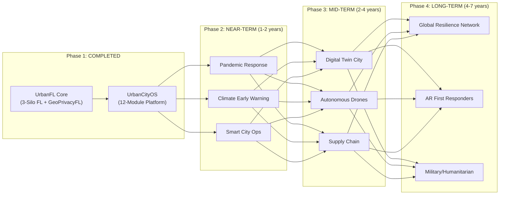

# Groundbreaking Extensions — UrbanCityOS

## Beyond Disaster Response: A Platform for Urban Resilience

UrbanCityOS, built on the UrbanFL federated learning substrate, is not merely a disaster response tool — it is an **operating system for urban resilience**. The 12-module architecture described in this work lays the foundation for applications far beyond earthquake response. This section outlines ten visionary extension domains, each enabled by the unique combination of privacy-preserving multi-modal federated learning, real-time infrastructure awareness, and predictive analytics.

---

## Extension 1: Pandemic Response & Health Surveillance

**Core Insight**: UrbanCityOS's privacy-first architecture is uniquely suited to pandemic surveillance, where individual health data is among the most sensitive categories.

### Capabilities

| Feature | Mechanism |
|---------|-----------|
| **Wastewater genomic tracking** | Silo 1 ingests anonymised sewage pathogen signals; GeoPrivacyFL Layer 1 ensures no individual household is identifiable |
| **Hospital syndromic surveillance** | `HospitalNetwork` module extended to track symptom clusters across facilities without sharing patient-level records |
| **Contact-aware mobility modelling** | Silo 3's road graph becomes a movement graph; BPR congestion functions reinterpreted as contact-density proxies |
| **Vaccine distribution** | `ResourceManager` directly repurposed for cold-chain logistics; `DemandForecaster` predicts uptake per zone |
| **Quarantine zone management** | `CivilianRerouteEngine` establishes cordons; `AlertComposer` issues geo-targeted public health advisories |

### Privacy Innovation

Federated learning across hospitals enables syndromic signal detection (e.g., unusual pneumonia clusters) **without any hospital exposing individual patient records**. The Weight-Aware RDP composition (Theorem 5) ensures that a small clinic contributing $w_k = 0.05$ of the aggregate model enjoys $w_k^2 = 0.0025$-amplified privacy — stronger guarantees than large hospitals, preventing re-identification of rare-disease patients in small populations.

---

## Extension 2: Climate Early Warning System (CEWS)

**Core Insight**: Climate events unfold over hours to weeks, unlike sudden disasters. UrbanCityOS's predictive analytics can shift from **reactive** (earthquake response) to **anticipatory** (hurricane landfall planning).

### Capabilities

- **Multi-day flood propagation**: `FloodPropagation` model extended with ensemble weather forecasts, producing probabilistic inundation maps at T+6h, T+12h, T+24h, T+72h
- **Heat mortality prevention**: `EnvironmentalMonitor` integrates urban heat island models with `HospitalNetwork` capacity and `ResourceManager` cooling-station inventories
- **Wildfire–urban interface**: `FireSpreadModel` combined with `InfrastructureGridMonitor` predicts when power-line-induced ignitions enter the urban perimeter
- **Sea level + storm surge**: `CascadePredictor` models pumping station failures under sustained inundation, critical for coastal cities

### Unique Advantage

UrbanCityOS provides **infrastructure-aware** climate warnings. Existing CEWS platforms (WMO MHEWS, FEMA IPAWS) predict weather; UrbanCityOS predicts **consequences** — "if flooding reaches Zone 3-4, the water treatment plant fails in 4 hours, triggering a boil-water advisory for 200,000 residents."

---

## Extension 3: Smart City Operations (Non-Disaster Mode)

**Core Insight**: The same sensing and routing infrastructure operates continuously in **peacetime**, providing daily urban management.

### Capabilities

| Peacetime Module | Derived From | Application |
|------------------|-------------|-------------|
| Traffic signal optimisation | `CivilianRerouteEngine` | Green-wave corridors, dynamic lane assignment |
| Air quality management | `EnvironmentalMonitor` | School recess scheduling, park advisories |
| Utility demand forecasting | `InfrastructureGridMonitor` | Peak load shifting, predictive maintenance |
| Public transit optimisation | `EmergencyRouter` + road graph | Demand-responsive transit routing |
| Waste collection routing | `ResourceManager` + graph | Bin-fill prediction → dynamic collection routes |
| Noise enforcement | `EnvironmentalMonitor.noise` | Construction-hour violation detection |

### Dual-Mode Architecture

UrbanCityOS operates in two modes with seamless transition:

```
PEACETIME ──[trigger]──→ EMERGENCY
   │                        │
   └── daily optimisation   └── disaster response
       (same modules)           (same modules, crisis parameters)
```

The `SituationMonitor` continuously runs zone criticality scoring. When any zone crosses the P3 threshold, the system **automatically transitions to emergency mode**, pre-positioning resources before human commanders even issue orders.

---

## Extension 4: International Humanitarian Assistance

**Core Insight**: Cross-border disaster response suffers from **data sovereignty** constraints — countries refuse to share sensitive infrastructure and population data. Federated learning is the natural solution.

### Architecture

```
Country A (Silo)          Country B (Silo)          Int'l Coordinator
  Infrastructure map        Infrastructure map        Aggregated model
  Population data           Population data           (no raw data visible)
  Hospital capacity         Hospital capacity
       │                         │                         │
       └─────────── FL Protocol ──────────────┘
```

### Applications

- **Cross-border earthquake response** (e.g., Turkey–Syria 2023): Coordinate ambulance routing across borders without sharing military-sensitive infrastructure maps
- **Refugee corridor optimisation**: `CivilianRerouteEngine` plans evacuation routes across international boundaries
- **WHO pandemic coordination**: Federated syndromic surveillance across nations with strict data sovereignty
- **UN OCHA logistics**: `ResourceManager` coordinates supply chains across multiple national jurisdictions

### Privacy Guarantee

GeoPrivacyFL ensures that participating countries receive the **benefits of shared intelligence** (improved models) without revealing exact hospital locations, military installations, or population distributions. Layer 5 (Verifiable Commitments) provides cryptographic proof that each country actually applied the promised privacy mechanisms.

---

## Extension 5: Supply Chain Resilience

**Core Insight**: Modern supply chains are as interconnected as urban infrastructure. The `CascadePredictor` generalises to supply network failures.

### Capabilities

- **Port disruption modelling**: When a port closes (e.g., Suez Canal blockage), predict downstream shortages per city zone using the infrastructure dependency DAG
- **Last-mile delivery during crisis**: `EmergencyRouter` repurposed for delivery vehicle routing with road damage overlay
- **Pharmaceutical cold chain**: `ResourceManager` tracks temperature-sensitive medical supplies with real-time monitoring
- **Food security mapping**: `DemandForecaster` predicts per-zone food requirements; `MutualAidBroker` coordinates inter-city supply transfers

### Integration with Existing Modules

The `InfrastructureGridMonitor` extends naturally to model supply networks:
- Power grid → Supply chain links
- Node status (operational/degraded/failed) → Supplier status
- Cascade prediction → Ripple effect analysis

---

## Extension 6: Military & Civil Defense

**Core Insight**: Military C2 (Command and Control) systems face the **exact same challenges** as disaster response — multi-source intelligence fusion, real-time routing under constraints, and strict information compartmentalisation.

### Dual-Use Capabilities

| UrbanCityOS Module | Military Application |
|---------------------|---------------------|
| `SituationMonitor` | Common Operating Picture (COP) |
| `ZoneCriticalityScorer` | Threat assessment / area prioritisation |
| `EmergencyRouter` | Convoy route planning with IED-avoidance overlay |
| `AerialNavAdvisor` | UAV mission planning with no-fly zone integration |
| `CommandCenter` | ICS-compliant → NATO STANAG-compliant command structure |
| `RecoveryTracker` | Post-conflict stabilisation tracking |
| GeoPrivacyFL | Intelligence fusion across coalition partners without sharing classified data |

### CBRN (Chemical, Biological, Radiological, Nuclear) Extension

The `EnvironmentalMonitor` extends to CBRN scenarios:
- Chemical plume modelling (Gaussian dispersion with wind data)
- Radiological fallout prediction
- Biological agent spread modelling (aerosol dynamics)
- Evacuation routing that accounts for contamination zones

---

## Extension 7: Digital Twin City

**Core Insight**: UrbanCityOS already maintains a real-time model of every major urban system. The next step is a **full digital twin** — a live, interactive mirror of the physical city.

### Components

1. **Physical twin**: IoT sensors, traffic cameras, utility meters → continuous data streams
2. **Digital twin**: UrbanCityOS data model → real-time state representation
3. **Predictive twin**: `ScenarioSimulator` → "what-if" analysis across the entire city

### Use Cases

- **Pre-disaster planning**: "What if a M7.0 earthquake hits during rush hour vs. 3 AM?"
- **Infrastructure investment**: "If we upgrade Water Pump Station 7, how does city resilience change?"
- **Urban development**: "Will this new high-rise create a traffic bottleneck that delays emergency response?"
- **Training**: Emergency managers run realistic exercises against the digital twin

### Technical Foundation

The digital twin leverages:
- `SituationMonitor` → live state across all 12 subsystems
- `ScenarioSimulator` → parametric what-if analysis
- `CascadePredictor` → cross-system failure propagation
- `RecoveryTracker` → temporal evolution modelling

---

## Extension 8: Autonomous Drone Swarm Coordination

**Core Insight**: Silo 2's aerial intelligence module already models drone coverage and response times. The extension to **autonomous swarm coordination** is a natural evolution.

### Architecture

```
                    ┌──────────────┐
                    │  FL Server   │
                    │  (Global     │
                    │   Model)     │
                    └──────┬───────┘
                           │
         ┌─────────────────┼─────────────────┐
         │                 │                 │
    ┌────┴────┐      ┌────┴────┐      ┌────┴────┐
    │ Swarm A │      │ Swarm B │      │ Swarm C │
    │ (Search)│      │ (Supply)│      │ (Survey)│
    └─────────┘      └─────────┘      └─────────┘
```

### Capabilities

- **Federated swarm learning**: Each drone learns from its observations; swarm model updated via FL without transmitting raw imagery over bandwidth-limited links
- **Adaptive coverage**: `CoverageTheorems` extended to dynamic target allocation — drones automatically reposition as new damage zones are discovered
- **Damage-aware flight planning**: `AerialNavAdvisor` routes drones around debris fields, smoke plumes, and no-fly zones
- **Relay communications**: When cellular towers fail (modelled by `InfrastructureGridMonitor`), drones form mesh relays for ground team communications

### Privacy Preservation

GeoPrivacyFL ensures that drone imagery shared in the FL pipeline does not leak precise locations of survivors (residential privacy), critical infrastructure vulnerabilities, or military assets.

---

## Extension 9: Augmented Reality for First Responders

**Core Insight**: All UrbanCityOS data can be projected onto first-responder AR displays, providing **superhuman situational awareness** in the field.

### AR Heads-Up Display Elements

| Layer | Data Source | Visualisation |
|-------|-----------|---------------|
| Building damage overlay | `DamageAssessor` | Red/yellow/green building outlines |
| Structural integrity | `EnvironmentalMonitor.vibration` | Real-time collapse risk indicator |
| Gas leak / hazmat zones | `EnvironmentalMonitor.air_quality` | Toxic plume boundary with wind vector |
| Victim heat signatures | Drone thermal (Silo 2) | Highlighted survivor locations |
| Optimal route arrows | `EmergencyRouter` | Turn-by-turn guidance through debris |
| Hospital availability | `HospitalNetwork` | Nearest hospitals with available capacity |
| Resource cache markers | `ResourceManager` | Nearby supply staging areas |

### Technical Requirements

- **Edge computing**: AR headsets run lightweight inference models trained via FL (reducing latency)
- **Mesh networking**: When infrastructure fails, AR devices form ad-hoc networks using drone relays
- **Privacy**: Survivor locations visible to authorised responders only; GeoPrivacyFL Layer 1 fuzzes locations on non-authorised displays

---

## Extension 10: Satellite Integration & Global Urban Resilience Network

**Core Insight**: UrbanCityOS deployed across multiple cities creates a **global urban resilience network**, with satellite observation providing the connective tissue.

### Architecture

```
    🛰️ Satellite Constellation
         │   │   │
    ┌────┘   │   └────┐
    ▼        ▼        ▼
 ┌──────┐ ┌──────┐ ┌──────┐
 │City A│ │City B│ │City C│
 │(Full │ │(Full │ │(Full │
 │CityOS│ │CityOS│ │CityOS│
 └──┬───┘ └──┬───┘ └──┬───┘
    │        │        │
    └────────┼────────┘
             ▼
      Global FL Server
     (Federated across cities)
```

### Capabilities

- **Cross-city federated learning**: Cities learn from each other's disaster responses WITHOUT sharing sensitive urban data
- **Satellite change detection**: Pre/post-disaster satellite imagery processed by each city's Silo 2, with FL enabling model improvement across hundreds of cities
- **Global vulnerability index**: Federated computation of city-level resilience scores, enabling international aid prioritisation
- **Disaster template library**: When City A experiences a flood, the learned response strategies are federated to City B (flood-prone) as preparedness intelligence

### Privacy at Scale

The GeoPrivacyFL framework scales naturally:
- Each city is a silo with full sovereignty over its data
- Weight-Aware RDP composition (Theorem 5) extends to $K \gg 3$ cities
- No centralised entity ever sees any city's raw infrastructure data
- The global model improves every city's disaster response capability

---

## Summary: The UrbanCityOS Research Roadmap



### What Makes This Possible

All ten extensions share a common enabler: **privacy-preserving, multi-modal, federated learning with formal guarantees**. Without GeoPrivacyFL, none of these cross-organisational, cross-jurisdictional, cross-national applications is feasible — no entity will share raw data. UrbanCityOS demonstrates that you don't have to.

### Impact Potential

| Metric | Current Best | UrbanCityOS Target |
|--------|-------------|-------------------|
| Alert-to-action latency | 15 min (FEMA IPAWS) | < 5 min |
| Cross-agency data sharing | 0% (siloed) | 100% (via FL) |
| Privacy guarantee | None or uniform ε | Per-source adaptive $\varepsilon_k$ with formal certificate |
| Infrastructure cascade prediction | Post-hoc analysis | Real-time (< 30s) |
| Recovery tracking continuity | Separate systems | Full lifecycle (response → reconstruction) |
| Global disaster learning | None | Federated across 50+ cities |
